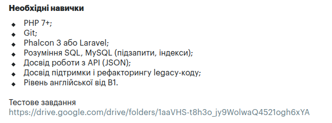

# CSV Import

**Original task (Ukrainian):**
>Завдання: зробити сторінку імпорту заявок (файл для імпорту надається).
>Задача рахується виконаною, якщо в базі запишуться всі рядки при стандартному max_execution_time=30
>Тестове завдання потрібно скинути на github (файли і структуру БД) і надати посилання.



## Environment

The project targets **Laravel 8** on purpose. The job description mentions working
with legacy code, so the task is solved with the constraints of an older stack
rather than the latest Laravel release: Laravel Mix instead of Vite, no PHP 8.1+
features, and MySQL 5.7.

| Component  | Version          | Notes                                              |
|------------|------------------|----------------------------------------------------|
| PHP        | 7.4 (FPM)        | `max_execution_time = 30` for web requests         |
| Laravel    | 8.x              |                                                    |
| MySQL      | 5.7              |                                                    |
| Valkey     | 8                | Redis-compatible fork; used for queue, cache, sessions |
| Node.js    | 18               | Builds assets with Laravel Mix                     |
| nginx      | alpine           |                                                    |

### Services (`docker-compose.yml`)

| Service        | Purpose                                                                 |
|----------------|-------------------------------------------------------------------------|
| `app`          | PHP-FPM application                                                     |
| `queue-worker` | Runs `php artisan queue:work`. `restart: unless-stopped` acts as the process supervisor: Docker brings the worker back if it exits on a job timeout |
| `nginx`        | Web server, <http://localhost> (port set by `APP_PORT`)                 |
| `db`           | MySQL 5.7                                                               |
| `valkey`       | Queue, cache and session storage                                        |
| `node`         | Installs npm packages and runs `npm run watch-poll`. The first start takes a few minutes |
| `adminer`      | Database UI at <http://localhost:8080> for inspecting `leads`, `imports` and `import_errors` |

### PHP limits

| Setting               | Web (FPM) | CLI (worker) |
|-----------------------|-----------|--------------|
| `max_execution_time`  | 30        | 0 (unlimited); jobs are limited by the worker `--timeout` instead |
| `upload_max_filesize` | 100M      | —            |
| `post_max_size`       | 100M      | —            |

Upload validation allows files up to 50 MB, below the PHP and nginx limits, so an
oversized file gets a normal validation error instead of a 413 response.

## Getting started

1. Copy the environment example:

   ```
   cp env.example .env
   ```

2. Build and start:

   ```
   docker compose up -d --build
   ```

   If `src/` is empty, the `app` container bootstraps a fresh Laravel project
   into it on first run (see `docker/php/entrypoint.sh`) and generates
   `APP_KEY`. If `src/` already has an app, it's reused as-is; `composer install`
   only runs when `vendor/` is missing.

3. Run the migrations:

   ```
   docker compose exec app php artisan migrate
   ```

4. Open <http://localhost> (port configurable via `APP_PORT` in `.env`).

5. Open /imports/create, upload a CSV, the queue-worker service processes it in the background; the page shows progress and a link to the error report

### Result on the provided file (100 000 rows)

| Outcome                           | Rows   | Where                         |
|-----------------------------------|--------|-------------------------------|
| Imported as leads                 | 98 976 | `leads`                       |
| Repeated `external_id` (merged)   | 202    | `leads` (updated, not duplicated) |
| Invalid, reported with line number| 822    | `import_errors` (with raw data)   |
| **Total**                         | **100 000** |                          |

## Running tests

Tests use a separate `laravel_testing` database, so the test suite does not touch the regular `laravel` database.

Create the test database once:

```
docker compose exec db mysql -u root -p
```

Enter the MySQL root password specified in .env (MYSQL_ROOT_PASSWORD).

Then create the database and grant access to the MySQL user specified by
`DB_USERNAME` in `.env`.

Replace `laravel` in the `GRANT` statement with the value of `DB_USERNAME` from your `.env` file:

```
CREATE DATABASE laravel_testing;
GRANT ALL PRIVILEGES ON laravel_testing.* TO 'laravel'@'%';
FLUSH PRIVILEGES;
```

Then type `exit` and run the tests:

```
docker compose exec app php artisan test
```